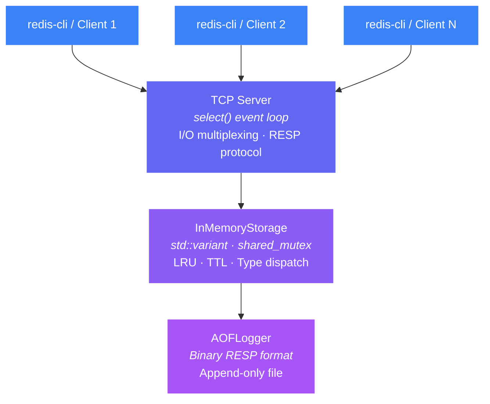
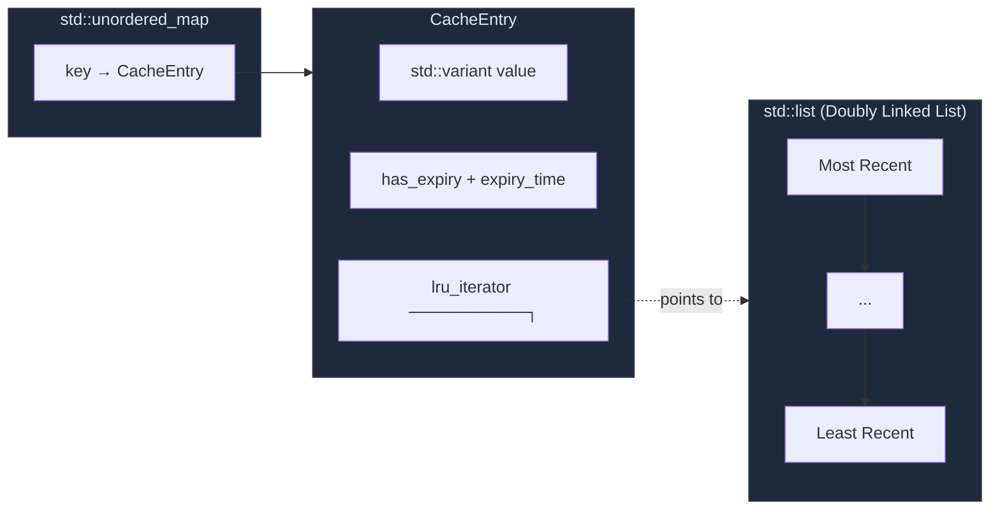

# Mini-Redis — Redis-Compatible In-Memory Key-Value Server in C++17

A Redis-compatible server built from scratch in **C++17**: a **TCP server speaking RESP** (works with `redis-cli` and `redis-benchmark`), a **single-threaded `select()` event loop**, **append-only-file (AOF) persistence**, **4 data types**, **O(1) LRU eviction**, **lazy TTL expiration**, and a **reader–writer-locked storage engine**.

This is a learning project, not production software. What it does not handle yet is listed under [Known Limitations](#known-limitations).

---

## Performance: Linux baseline

Mini-Redis against real Redis 7.0.15 on the same machine, with the same durability: both write their AOF to the OS without `fsync`. 1,000,000 requests per test, 100,000 random keys, 50 clients; middle of 3 runs. Intel Core Ultra 5 125H laptop, Ubuntu 24.04 under WSL2, GCC 13 `-O2`. Full results, commands and caveats: [bench/results/v0-baseline](bench/results/v0-baseline/).

| Test | Mini-Redis | Redis | Mini-Redis / Redis |
|---|---:|---:|---:|
| SET, no pipelining, AOF on | 19,336 req/s | 19,971 req/s | 0.97× |
| GET, no pipelining, AOF on | 19,868 req/s | 20,481 req/s | 0.97× |
| SET, pipeline 16, AOF on | 75,358 req/s | 173,581 req/s | 0.43× |
| GET, pipeline 16, AOF on | 114,103 req/s | 203,583 req/s | 0.56× |
| SET, pipeline 16, AOF off | 124,813 req/s | 249,626 req/s | 0.50× |
| Startup, replaying a 1,000,000-command AOF (45 MB) | over 15 min | 1.2 s | |

What the measurements show:
- **Without pipelining, the tie says nothing about the code.** Neither server reaches 100% CPU: the cost of each network round trip (system calls, mostly in the kernel) sets the pace for both.
- **With pipelining, Mini-Redis is the bottleneck (100% CPU) at about half of Redis's throughput.** The profile shows where it goes: 24–40% of its CPU is `send()`, one call per reply, where Redis writes a client's replies once per event-loop pass; with AOF on, 35% of `SET` is AOF logging, one `write()` per command; and 10–17% is hash lookups, because each command looks its key up two or three times.
- **AOF replay is quadratic:** each command is erased from the front of a buffer holding the rest of the file. 400,000 commands take 2 min 54 s.
- **316 bytes of heap per key** for a 16-byte key and a 3-byte value.

These are the starting point for the planned fixes. Run-to-run spread on this machine reaches 33% (WSL2 on a hybrid CPU), so every result is reported with its spread.

> **Why does pipelining help so much?** Without pipelining, every command waits a full network round trip. With P=16 the client sends 16 commands at once, the server reads them with a single `recv()`, and the round trip is shared by 16 commands. The server still makes one `send()` call per reply; batching replies is planned.

Earlier numbers from Windows (one key for every request, unoptimised build) are kept in [stress-test-results/](stress-test-results/); they are not comparable.

---

## Architecture



**Single-threaded event loop:** one thread waits on all sockets with `select()` and runs each command to completion, so commands never race each other. Redis's main thread uses the same model, but with `epoll`/`kqueue` instead of `select()`.

### Layered Design

| Layer | File(s) | Responsibility |
|-------|---------|----------------|
| **Network** | `Server.h/.cpp` | TCP accept, `select()` loop, RESP encode/decode, command dispatch |
| **Protocol** | `RespParser.h` | RESP parsing (binary-safe) + inline command support |
| **Controller** | `RedisLite.h/.cpp` | Input validation, command routing (used by the CLI; the server calls the engine directly) |
| **Engine** | `InMemoryStorage.h/.cpp` | LRU, TTL, type dispatch, AOF integration |
| **Persistence** | `AOFLogger.h` | Append-only file I/O in RESP format |
| **Entry points** | `server_main.cpp`, `main.cpp` | Server (command-line flags) and interactive CLI |

---

## Supported Data Types

| Type | Commands | Internal Structure |
|------|----------|-------------------|
| **String** | `SET`, `GET`, `SETEX` | `std::string` |
| **List** | `LPUSH`, `RPUSH`, `LPOP`, `RPOP`, `LRANGE`, `LLEN` | `std::deque<string>` |
| **Set** | `SADD`, `SREM`, `SMEMBERS`, `SISMEMBER`, `SCARD` | `std::unordered_set<string>` |
| **Hash** | `HSET`, `HGET`, `HDEL`, `HGETALL`, `HLEN` | `std::unordered_map<string,string>` |

All types are stored in a single `std::variant`:
- **Benefits:** no virtual calls, no separate heap object per value, and type checks at compile time.
- **Cost:** size. Every value is as large as the largest alternative plus a type tag.

Measured on x86-64 Linux with GCC 13 (libstdc++):

| Type | `sizeof` (bytes) |
|------|:----------------:|
| `std::string` | 32 |
| `std::deque<std::string>` (largest alternative) | 80 |
| `std::unordered_set` / `std::unordered_map` | 56 |
| `ValueType` (the variant) | 88 |
| `CacheEntry` (variant + TTL + LRU iterator) | 112 |

So a 3-byte string value still occupies 88 bytes inside the variant. Other compilers and standard libraries give different sizes.

---

## Core Features

### 1. TCP Server with RESP Protocol

Works with `redis-cli` and `redis-benchmark`: it answers the `COMMAND`, `CLIENT` and `CONFIG GET` calls they make at startup. It supports:
- **RESP arrays** (`*3\r\n$3\r\nSET\r\n...`) — binary-safe, length-prefixed
- **Inline commands** (`PING\r\n`) — for telnet/debugging
- **Per-client receive buffers** — handles TCP stream reassembly correctly
- **Pipelining** — runs every complete command found in each `recv()` call
- **`TCP_NODELAY`** — disables Nagle's algorithm, so small replies aren't held back to be batched

```bash
# Connect with redis-cli
redis-cli -p 6379
127.0.0.1:6379> SET name "hello world"
OK
127.0.0.1:6379> GET name
"hello world"
```

### 2. I/O Multiplexing (`select()`)

```
Before: accept() → handle client → BLOCKS → accept() next
After:  select() waits on all sockets at once → handle whichever are ready
```

- **One thread:** handles all concurrent clients without spawning threads.
- **Cost of `select()`:** it scans every socket on every call, so each call is O(N) in the number of connections.
- **Safe iteration:** the client list is copied before iterating, which prevents iterator invalidation.
- **1-second timeout:** lets the loop re-check its running flag. There's no Ctrl+C handler yet, so Ctrl+C ends the process directly.
- **SIGPIPE ignored (Linux/macOS):** a client that disconnects early can't kill the server. Writes to it fail with `EPIPE` instead (see Challenge 7).

### 3. AOF Persistence

Every write command is appended to `appendonly.aof` in **binary RESP format**:

```
Plain text:  "SET greeting hello world"     → BREAKS on replay (spaces)
RESP format: "*3\r\n$3\r\nSET\r\n$8\r\ngreeting\r\n$11\r\nhello world\r\n"
             ↑ length-prefixed → binary-safe ✓
```

| Feature | Details |
|---------|---------|
| Durability | `flush()` after every command. The data survives a process crash, but without `fsync` a power cut or OS crash can lose recent writes. |
| Binary safety | RESP format — spaces, newlines, any byte in values |
| Replay on startup | `replayAOF()` rebuilds state from the file |
| Compaction | `BGREWRITEAOF` rewrites the file with the minimal set of commands. Despite the name, it runs in the foreground; see [Known Limitations](#known-limitations). |
| Configuration | `--appendonly no` disables it; `--appendfilename` chooses the file |

### 4. O(1) LRU Eviction



- HashMap for O(1) lookup + doubly-linked list for O(1) reordering
- Iterator stored in each entry — no linear scan to find position
- Capacity is set with `--maxkeys` (default 10,000)
- Before `SET` evicts, it removes expired keys from the least-recently-used end of the list. An expired key elsewhere in the list is not removed, so a live key can still be evicted while expired keys remain.

### 5. Thread Safety

`std::shared_mutex` (reader-writer lock) — concurrent reads, exclusive writes.

| Method | Lock Type | Why |
|--------|-----------|-----|
| `GET`, `EXISTS` | `unique_lock` | Lazy expiration may trigger write |
| `SET`, `DEL`, `EXPIRE` | `unique_lock` | Modifies data |
| `TTL`, `TYPE`, `LRANGE` | `shared_lock` | Pure read |
| `SAVE` | `shared_lock` | Snapshot is read-only |

The single-threaded server doesn't need this lock. It exists so the storage engine is safe to use from several threads, which the stress tests do.

---

## Challenges Faced & Solutions

### Challenge 1: TCP Stream Reassembly

**Problem:** TCP doesn't preserve message boundaries. One `recv()` call might return half a command, or three commands concatenated together.

**Wrong approach:** Assume each `recv()` = one complete command. This works in testing but breaks under load.

**Solution:** Per-client receive buffer (`std::unordered_map<socket_t, string>`). Data is appended on each `recv()`. The parser extracts complete commands and leaves partial data in the buffer for the next `recv()`.

```cpp
// Process ALL complete commands, leave incomplete data for next recv()
while(!buffer.empty()) {
    auto [args, consumed] = RespParser::parse(buffer);
    if(consumed == 0) break;    // incomplete — wait for more data
    buffer.erase(0, consumed);
    executeCommand(args);
}
```

### Challenge 2: Binary Safety in Persistence

**Problem:** Values with spaces (`"hello world"`) break plain-text AOF parsing. `istringstream >> val` stops at the first space.

```
AOF line:   SET greeting hello world
Replay:     key="greeting", value="hello"  ← "world" is LOST
```

**Solution:** Switched AOF format from plain text to RESP (length-prefixed binary). `$11\r\nhello world\r\n` tells the parser "read exactly 11 bytes" — spaces are preserved.

### Challenge 3: Iterator Invalidation in select() Loop

**Problem:** When processing client data, a client might disconnect (QUIT or error). `removeClient()` erases from `client_buffers_` map. If we're iterating the map, this is undefined behavior.

**Solution:** Copy the client list before iterating:

```cpp
std::vector<socket_t> clients;
for(const auto& [client, _] : client_buffers_)
    clients.push_back(client);

for(socket_t client : clients) {
    if(client_buffers_.count(client) && FD_ISSET(client, &readfds))
        handleClientData(client);
}
```

### Challenge 4: Expired Keys Must Behave as Absent

**Problem:** Expiry is lazy: an expired key stays in memory until something touches it. `DEL` didn't check expiry, so `DEL` on a key whose TTL had passed returned 1 ("deleted") and logged a `DEL` to the AOF. Redis returns 0, because logically the key no longer exists.

**Solution:** `DEL` now checks `isExpired()` first, like `GET` and `EXISTS`. An expired key is removed silently, `DEL` returns 0, and nothing is logged.

### Challenge 5: BGREWRITEAOF Was Silently Broken

**Problem:** The server's `BGREWRITEAOF` command called `dumpState()` but threw away the result. Compaction appeared to work but did nothing.

**Root cause:** Server didn't have access to AOFLogger — only InMemoryStorage did.

**Solution:** Pass `AOFLogger*` to Server constructor. BGREWRITEAOF now calls `aof_->rewrite(commands)`.

**Still open:** the rewrite truncates the live AOF before writing the new contents, so a crash in between loses the file. The standard fix is to write a temporary file, `fsync` it, and `rename()` it over the old one; on POSIX file systems the rename replaces the file atomically.

### Challenge 6: Cross-Platform Socket Portability

**Problem:** Socket APIs differ between Windows (Winsock) and Linux (POSIX). Even `close()` vs `closesocket()`, `SOCKET` vs `int`.

**Solution:** Platform abstraction via preprocessor macros:

```cpp
#ifdef _WIN32
    using socket_t = SOCKET;
    #define CLOSE_SOCKET closesocket
#else
    using socket_t = int;
    #define CLOSE_SOCKET close
#endif
```

### Challenge 7: One Disconnecting Client Could Kill the Server

**Problem:** On Linux, calling `send()` on a socket whose client has already closed raises `SIGPIPE`, and the default action of `SIGPIPE` terminates the process. A client that sent a batch of commands and disconnected without reading the replies took the whole server down, for every client.

**How it was found:** an integration test sends 10,000 pipelined `PING`s, closes the socket without reading, then checks that the server is still alive. It failed with `server died (killed by SIGPIPE)`.

**Solution:** The server ignores `SIGPIPE` at startup (`std::signal(SIGPIPE, SIG_IGN)`), as Redis does. `send()` then fails with `EPIPE`, and the client is removed on its next `recv()`. Windows has no `SIGPIPE`.

---

## Full Command Reference

### String Commands
| Command | Syntax | Description |
|---------|--------|-------------|
| `SET` | `SET key value` | Set key-value pair |
| `SET` | `SET key value EX seconds` | Set with TTL in seconds (`PX` and other `SET` options are not supported yet) |
| `SETEX` | `SETEX key seconds value` | Set with TTL (alternative) |
| `GET` | `GET key` | Get value |

### Key Commands
| Command | Syntax | Description |
|---------|--------|-------------|
| `DEL` | `DEL key` | Delete key |
| `EXISTS` | `EXISTS key` | Check existence |
| `TYPE` | `TYPE key` | Get data type |
| `EXPIRE` | `EXPIRE key seconds` | Set TTL |
| `TTL` | `TTL key` | Get remaining TTL |

### List Commands
| Command | Syntax | Description |
|---------|--------|-------------|
| `LPUSH` | `LPUSH key val1 val2 ...` | Push to head |
| `RPUSH` | `RPUSH key val1 val2 ...` | Push to tail |
| `LPOP` | `LPOP key` | Pop from head |
| `RPOP` | `RPOP key` | Pop from tail |
| `LRANGE` | `LRANGE key start stop` | Get range (supports negative indices) |
| `LLEN` | `LLEN key` | Get list length |

### Set Commands
| Command | Syntax | Description |
|---------|--------|-------------|
| `SADD` | `SADD key m1 m2 ...` | Add members |
| `SREM` | `SREM key m1 m2 ...` | Remove members |
| `SMEMBERS` | `SMEMBERS key` | Get all members |
| `SISMEMBER` | `SISMEMBER key member` | Check membership |
| `SCARD` | `SCARD key` | Get set size |

### Hash Commands
| Command | Syntax | Description |
|---------|--------|-------------|
| `HSET` | `HSET key f1 v1 f2 v2 ...` | Set fields |
| `HGET` | `HGET key field` | Get field value |
| `HDEL` | `HDEL key f1 f2 ...` | Delete fields |
| `HGETALL` | `HGETALL key` | Get all field-value pairs |
| `HLEN` | `HLEN key` | Get number of fields |

### Server Commands
| Command | Description |
|---------|-------------|
| `PING` | Returns PONG |
| `INFO` | Server info (version, connected clients) |
| `SAVE` | Writes string keys only to `dump.rdb`. Lists, sets, hashes and TTLs are skipped, and the server doesn't load this file at startup. |
| `BGREWRITEAOF` | Compacts the AOF. Runs in the foreground, blocking other clients. Returns an error when AOF is disabled. |
| `QUIT` | Disconnect client |

---

## Complexity

| Operation | Time | Space |
|-----------|:----:|:-----:|
| SET / GET / DEL | O(1) average | O(1) |
| LPUSH / RPUSH | O(1) per element | O(1) per element |
| LPOP / RPOP | O(1) | O(1) |
| LRANGE | O(K) | O(K) |
| SADD / SREM / SISMEMBER | O(1) average per member | O(1) |
| HSET / HGET / HDEL | O(1) average per field | O(1) |
| SAVE / LOAD | O(N) | O(N) |
| BGREWRITEAOF | O(N) | O(N) |

Overall space: **O(N)** where N = number of stored keys (bounded by `--maxkeys`).

---

## Tests

**55 unit tests** (`tests/test_main.cpp`):

```
========== Mini-Redis Test Suite ==========

[Basic Operations]      7 tests    ✅
[LRU Eviction]          4 tests    ✅
[TTL Expiration]        5 tests    ✅
[TTL > LRU Priority]    1 test     ✅
[Persistence]           4 tests    ✅
[Controller Validation] 1 test     ✅
[List Operations]       6 tests    ✅
[Set Operations]        5 tests    ✅
[Hash Operations]       5 tests    ✅
[Type Safety]           4 tests    ✅
[LRU with Mixed Types]  1 test     ✅
[AOF Persistence]       7 tests    ✅  (includes binary-safety regression test)
[RESP Parser]           5 tests    ✅

Results: 55 passed, 0 failed
```

**Thread-safety stress tests** (`tests/test_thread_safety.cpp`):
- 5 tests, each running 8 threads at once against one storage instance (20,000 operations in total).
- They check for crashes and invalid results. Build with `-DSANITIZE=thread` to have ThreadSanitizer check for data races.

**Integration tests** (`tests/integration/test_server.py`, Python standard library only):
- 10 tests that start the real server binary on a free port and speak RESP over TCP.
- They cover basic commands, command-line flags, AOF replay after a restart, and the client-disconnect regression from Challenge 7.

All three suites run under `ctest` and pass with AddressSanitizer + UndefinedBehaviorSanitizer. The thread-safety tests also pass under ThreadSanitizer.

---

## Project Structure

```
mini-redis/
├── server_main.cpp           # Server entry point (TCP mode, command-line flags)
├── main.cpp                  # CLI entry point (interactive mode)
├── Server.h / .cpp           # TCP server — select() event loop, RESP I/O
├── RespParser.h              # RESP protocol parser + serializer (header-only)
├── RedisLite.h / .cpp        # Controller — input validation, command routing (CLI)
├── StorageInterface.h        # Abstract interface (pure virtual base class)
├── InMemoryStorage.h / .cpp  # Storage engine — LRU, TTL, variant types, AOF
├── AOFLogger.h               # Append-only file persistence (header-only)
├── Result.h                  # Result type with error codes
├── CMakeLists.txt            # CMake build (C++17, warnings, optional sanitizers)
├── .gitignore
├── bench/                    # Measurement scripts (throughput, replay, profile, memory)
│   └── results/              # Measured results, one directory per version
├── stress-test-results/      # Earlier Windows benchmark screenshots (superseded)
└── tests/
    ├── test_main.cpp              # 55 unit tests
    ├── test_thread_safety.cpp     # Concurrency stress tests (5 tests x 8 threads)
    └── integration/
        └── test_server.py         # Integration tests against the real server binary
```

---

## Build & Run

**Prerequisites:**
- A C++17 compiler with `<charconv>`, e.g. GCC 8 or newer. Tested with GCC 13 on Ubuntu 24.04.
- CMake 3.16+.
- Python 3, optional, for the integration tests.

### Build and test (CMake)

```bash
cmake -B build                            # defaults to RelWithDebInfo: -O2 with debug symbols
cmake --build build -j
cd build && ctest --output-on-failure     # unit, thread-safety and integration tests
```

### Run the server

```bash
./build/mini_redis_server                 # port 6379, 10,000 keys, AOF in ./appendonly.aof
./build/mini_redis_server --port 6380 --maxkeys 1000000 --appendonly no
./build/mini_redis_server --help

# Connect with redis-cli (in another terminal)
redis-cli -p 6379
```

| Option | Default | Meaning |
|--------|---------|---------|
| `--port <1-65535>` | 6379 | TCP port to listen on |
| `--maxkeys <n>` | 10000 | Keys to hold before LRU eviction |
| `--appendonly <yes\|no>` | yes | Log writes to the AOF and replay it at startup |
| `--appendfilename <path>` | appendonly.aof | AOF file; the server refuses to start if it can't be opened |

### Benchmark

The numbers in this README come from the scripts in [`bench/`](bench/). They build an optimised binary, run Mini-Redis and real Redis the same way, repeat each test 3 times, and record the machine, compiler and commit next to the results. [bench/README.md](bench/README.md) explains the method.

```bash
python3 bench/bench.py --out bench/results/my-run      # Linux; about 25 minutes
```

For a quick manual run:

```bash
rm -f appendonly.aof                      # the AOF keeps growing across runs
./build/mini_redis_server --maxkeys 1000000
redis-benchmark -p 6379 -t set,get -n 1000000 -r 100000 -c 50
```

- `-r 100000` spreads requests over 100,000 random keys; without it, every request hits one key.
- `--maxkeys` must be at least that many, or most `SET`s also evict.
- Leave out `-q` to see latency percentiles.

### Sanitizers (GCC/Clang)

```bash
# AddressSanitizer + UndefinedBehaviorSanitizer, all tests
cmake -B build-asan -DCMAKE_BUILD_TYPE=Debug -DSANITIZE=address,undefined
cmake --build build-asan -j
(cd build-asan && ctest --output-on-failure)

# ThreadSanitizer, concurrency tests
cmake -B build-tsan -DCMAKE_BUILD_TYPE=Debug -DSANITIZE=thread
cmake --build build-tsan -j --target test_threads
setarch "$(uname -m)" -R ./build-tsan/test_threads
```

> GCC 13's ThreadSanitizer stops with `unexpected memory mapping` on Linux kernels with high address-space randomisation (e.g. Ubuntu 24.04, WSL2). `setarch -R` disables randomisation for that one process.

### Interactive CLI

```bash
./build/mini_redis
```

### Without CMake

```bash
# Linux / macOS
g++ -std=c++17 -O2 -pthread server_main.cpp Server.cpp InMemoryStorage.cpp RedisLite.cpp -o mini_redis_server
g++ -std=c++17 -O2 -pthread main.cpp InMemoryStorage.cpp RedisLite.cpp -o mini_redis
g++ -std=c++17 -O2 -pthread tests/test_main.cpp InMemoryStorage.cpp RedisLite.cpp -o run_tests
g++ -std=c++17 -O2 -pthread tests/test_thread_safety.cpp InMemoryStorage.cpp RedisLite.cpp -o run_thread_tests
```

On Windows (MinGW), add `-lws2_32` to the server command for Winsock.

---

## Design Trade-offs

| Decision | Why |
|----------|-----|
| **`select()` over `epoll`/IOCP** | Portable across Windows, Linux and macOS. **Cost:** every call scans all sockets (O(N)), and on Linux `select()` can't watch socket numbers ≥ 1024. `epoll` is Linux-only. |
| **Single-threaded server** | Same model as Redis's main thread: commands run one at a time, so they can't race each other. **Cost:** one slow operation delays every client. |
| **RESP AOF over plain text** | Binary-safe. Values with spaces, newlines, special chars survive persistence. |
| **`flush()` over `fsync()`** | `fsync()` waits until the data is on disk, which is much slower than `flush()`, which only hands it to the OS. **Cost:** a power cut or OS crash can lose writes the OS hasn't written out yet; Linux typically writes them within about 30 seconds. |
| **`TCP_NODELAY` enabled** | Disables Nagle's algorithm. Trades bandwidth efficiency for latency — correct for request-response protocols. |
| **`std::variant` over inheritance** | No vtable pointer, no separate heap object per value, compile-time type checks. **Cost:** every value is as large as the largest alternative (88 bytes on x86-64 GCC 13, even for a 3-byte string). |
| **Lazy TTL over active expiration** | No background thread. O(1) per access. **Cost:** expired keys use memory until they're accessed or evicted. |
| **`shared_mutex` over lock-free** | Correct and easy to reason about. Lock-free structures can scale better under contention but are much harder to get right. The single-threaded server needs neither. |
| **Assert-based tests over gtest** | Zero dependencies (the integration tests use only Python's standard library). Tests are the spec — readable by anyone. |

---

## Known Limitations

Found while reviewing the code. Each one is planned to be fixed with a test that reproduces it first.

**Networking**

| Limitation | Planned fix |
|---|---|
| Sockets are blocking and the result of `send()` is ignored. A client that sends commands but never reads the replies fills its socket buffer, `send()` blocks, and the whole server stalls. | Non-blocking sockets with a per-client output buffer |
| Malformed RESP (e.g. `*abc`, `$-5`) is treated as "incomplete", so the connection stops making progress and its buffer grows without limit. A huge declared length (`$2000000000`) makes the server wait for that many bytes. | Parser that distinguishes complete / incomplete / invalid; protocol error and disconnect; size limits |
| On Linux, `fd_set` holds sockets 0–1023 only, and the 1,021st client gets socket 1024. Measured ([details](bench/results/v0-baseline/README.md#5-the-select-limit-bug-8)): the optimised build is aborted by glibc's `_FORTIFY_SOURCE` check, taking every client down; a build without that check keeps answering while reading and writing past the end of `fd_set`. On Windows, `FD_SETSIZE` defaults to 64 and `FD_SET` silently skips sockets once the set is full, so with more than 63 clients some would never be polled or served (from the Winsock headers; not tested). | Reject such connections; later move to `epoll` |
| No shutdown signal handling: Ctrl+C terminates the process immediately. | `SIGINT`/`SIGTERM` handler for a clean shutdown |

**Persistence**

| Limitation | Planned fix |
|---|---|
| No `fsync`: a power cut or OS crash can lose writes the OS hasn't written to disk yet. | Configurable policy: `always` / `everysec` / `no` |
| TTLs are logged as relative seconds (`SETEX key 10 …`). After a restart, replay gives keys their full TTL again, even keys that had already expired. | Log absolute expiry times (`PXAT` / `PEXPIREAT`, as Redis does) |
| Evictions and lazy expirations aren't logged, so after a restart a different set of keys can survive than on the live server. | Log a `DEL` for every removal the server makes on its own |
| `BGREWRITEAOF` runs in the foreground and truncates the live AOF before writing the new one. | Write a temp file, `fsync`, `rename()`; later a background (`fork()`) rewrite |
| Replay erases each command from the front of its buffer, so startup time grows quadratically with AOF size. Measured: 100,000 commands take 11.5 s, 400,000 take 2 min 54 s, 1,000,000 over 15 min; Redis loads the same files in 0.1 s, 0.4 s and 1.2 s. | Parse with a read position |
| An incomplete last record (crash mid-write) stops replay. Later writes are appended after it and are lost at the next restart. | Truncate the AOF to its last complete record at startup |
| `SAVE` writes only string keys, as `S\|key=value` lines, and the server never loads that file. | Remove it from the server or reuse the AOF format |

**Commands and storage**

| Limitation | Planned fix |
|---|---|
| `SET key value EX` with a missing or non-positive number, `SET … PX`, and `SETEX` with a TTL ≤ 0 store the key without a TTL instead of returning an error. | Full `SET` option parsing with errors |
| Expired keys are cleared before eviction only when they sit at the least-recently-used end of the list (see LRU section). | Remove expired keys before evicting a live one |

**Future scope:** sharding across nodes (consistent hashing), Pub/Sub (`SUBSCRIBE`/`PUBLISH`), `AUTH`.

---

<div align="center">

**Made by [Madhav Thesiya](https://www.linkedin.com/in/madhavthesiya/)** — If this was useful, drop a ⭐<br>
**© 2026 Madhav Thesiya. All Rights Reserved.**

</div>
