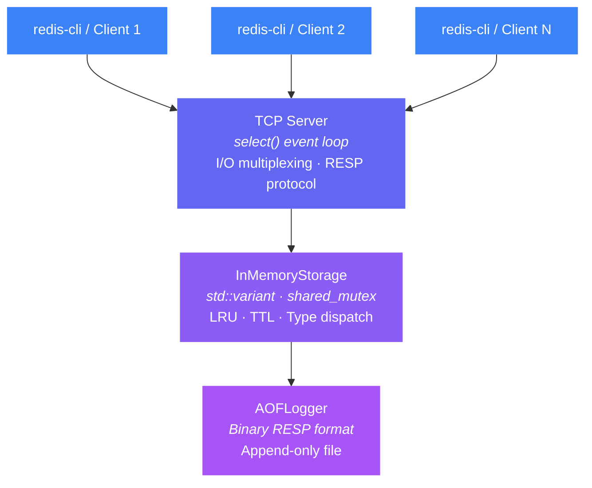
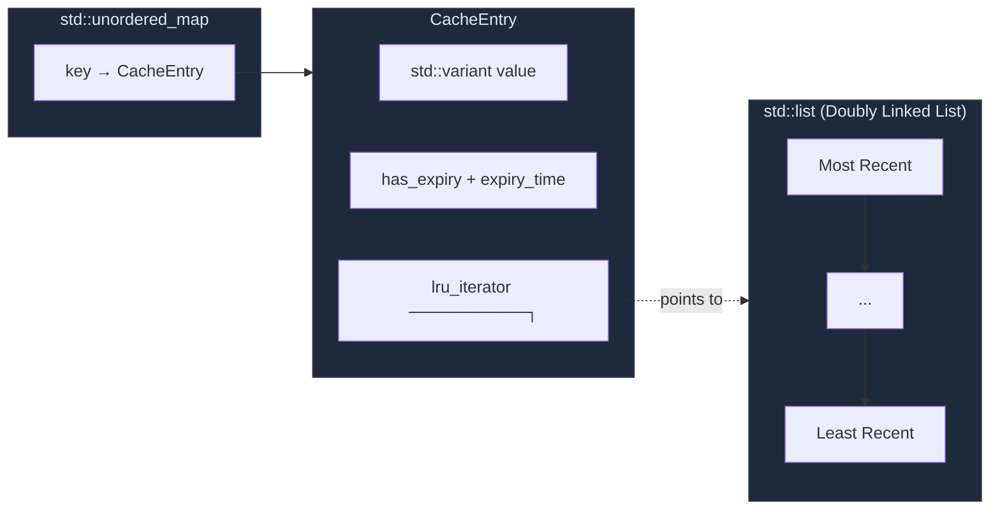

# Mini-Redis — Redis-Compatible In-Memory Key-Value Server in C++17

A Redis-compatible server built from scratch in **C++17**: a **TCP server speaking RESP** (works with `redis-cli` and `redis-benchmark`), a **single-threaded event loop with non-blocking sockets and per-client reply buffers**, **append-only-file (AOF) persistence**, **4 data types**, **O(1) LRU eviction**, **lazy TTL expiration**, and a **reader–writer-locked storage engine**.

This is a learning project, not production software. What it does not handle yet is listed under [Known Limitations](#known-limitations).

---

## Performance

Mini-Redis against real Redis 7.0.15 on the same machine, in the same session, with the same durability: both write their AOF to the OS without `fsync`. 100,000 random keys, 50 clients, middle of 3 runs. Intel Core Ultra 5 125H laptop, Ubuntu 24.04 under WSL2, GCC 13 `-O2`. Full results, commands and caveats: [after the network fixes](bench/results/after-network-fixes/README.md), and the starting point, [v0-baseline](bench/results/v0-baseline/README.md).

| Test | Mini-Redis | Redis | Mini-Redis / Redis | At v0-baseline |
|---|---:|---:|---:|---:|
| SET, no pipelining, AOF on | 24,616 req/s | 25,443 req/s | 0.97× | 0.97× |
| GET, no pipelining, AOF on | 26,291 req/s | 24,450 req/s | 1.08× | 0.97× |
| SET, pipeline 16, AOF on | 172,247 req/s | 213,192 req/s | 0.81× | 0.43× |
| GET, pipeline 16, AOF on | 282,008 req/s | 293,669 req/s | 0.96× | 0.56× |
| SET, pipeline 16, AOF off | 285,486 req/s | 285,339 req/s | 1.00× | 0.50× |
| Startup, replaying a 1,000,000-command AOF (45 MB) | over 15 min | 1.2 s | | |

What the measurements show:
- **The event-loop rewrite made pipelined throughput 1.45–1.71× faster** (before and after measured in one session). Nearly all of it came from sending the replies to a whole batch of commands with one `send()`, where there used to be one call per command.
- **Pipelined, Mini-Redis now reaches about the same throughput as Redis, but uses more CPU for it:** 1.10–1.14× Redis's CPU per request, and 1.33× for `SET` with AOF on.
- **The largest remaining costs are visible in the profile.** AOF logging takes 43% of pipelined `SET`, because it makes one `write()` per command where Redis writes once per event-loop pass. Hash lookups take 15–27%, because each command looks its key up two or three times.
- **Without pipelining, the tie says nothing about the code.** Neither server reaches 100% CPU: the cost of each network round trip sets the pace for both.
- **AOF replay is quadratic:** each command is erased from the front of a buffer holding the rest of the file. 400,000 commands take 2 min 54 s.
- **316 bytes of heap per key** for a 16-byte key and a 3-byte value.

Raw numbers vary between sessions on this machine (WSL2 on a hybrid CPU) by more than most code changes, so comparisons are made within one session and reported with their spread.

> **Why does pipelining help so much?** Without pipelining, every command waits a full network round trip. With P=16 the client sends 16 commands at once, the server reads them with a single `recv()` and sends all 16 replies with a single `send()`, and the round trip is shared by 16 commands.

Earlier numbers from Windows (one key for every request, unoptimised build) are kept in [stress-test-results/](stress-test-results/); they are not comparable.

---

## Architecture



**Single-threaded event loop:** one thread waits on all sockets with `select()` and runs each command to completion, so commands never race each other. Sockets are non-blocking, so the thread never waits on any one client. Redis's main thread uses the same model, but with `epoll`/`kqueue` instead of `select()`.

### Layered Design

| Layer | File(s) | Responsibility |
|-------|---------|----------------|
| **Network** | `Server.h/.cpp` | Accepting clients, the event loop, per-client buffers, command dispatch |
| **Readiness** | `Poller.h/.cpp` | Which sockets are ready (`select()` today, behind an interface `epoll` can implement) |
| **Portability** | `Socket.h` | Winsock vs BSD sockets: types, non-blocking mode, error codes |
| **Protocol** | `RespParser.h` | RESP parsing (binary-safe, with limits) + inline command support |
| **Controller** | `RedisLite.h/.cpp` | Input validation, command routing (used by the CLI; the server calls the engine directly) |
| **Engine** | `InMemoryStorage.h/.cpp` | LRU, TTL, type dispatch, AOF integration |
| **Persistence** | `AOFLogger.h` | Append-only file I/O in RESP format |
| **Entry points** | `server_main.cpp`, `main.cpp` | Server (command-line flags) and interactive CLI |

---

## Supported Data Types

| Type | Commands | Internal Structure |
|------|----------|-------------------|
| **String** | `SET`, `GET`, `SETEX` | `std::string` |
| **List** | `LPUSH`, `RPUSH`, `LPOP`, `RPOP`, `LRANGE`, `LLEN` | `std::deque<string>` |
| **Set** | `SADD`, `SREM`, `SMEMBERS`, `SISMEMBER`, `SCARD` | `std::unordered_set<string>` |
| **Hash** | `HSET`, `HGET`, `HDEL`, `HGETALL`, `HLEN` | `std::unordered_map<string,string>` |

All types are stored in a single `std::variant`:
- **Benefits:** no virtual calls, no separate heap object per value, and type checks at compile time.
- **Cost:** size. Every value is as large as the largest alternative plus a type tag.

Measured on x86-64 Linux with GCC 13 (libstdc++):

| Type | `sizeof` (bytes) |
|------|:----------------:|
| `std::string` | 32 |
| `std::deque<std::string>` (largest alternative) | 80 |
| `std::unordered_set` / `std::unordered_map` | 56 |
| `ValueType` (the variant) | 88 |
| `CacheEntry` (variant + TTL + LRU iterator) | 112 |

So a 3-byte string value still occupies 88 bytes inside the variant. Other compilers and standard libraries give different sizes.

---

## Core Features

### 1. TCP Server with RESP Protocol

Works with `redis-cli` and `redis-benchmark`: it answers the `COMMAND`, `CLIENT` and `CONFIG GET` calls they make at startup. It supports:
- **RESP arrays** (`*3\r\n$3\r\nSET\r\n...`) — binary-safe, length-prefixed
- **Inline commands** (`PING\r\n`) — for telnet/debugging
- **Per-client receive buffers** — handles TCP stream reassembly correctly
- **Pipelining** — runs every complete command found in each read, and sends all their replies with one `send()`
- **Protocol errors** — malformed input gets `-ERR Protocol error: …` and the connection is closed, as in Redis. Limits from Redis's defaults: bulk strings up to 512 MB, inline commands up to 64 KB, 1 GB of unfinished input per client
- **`TCP_NODELAY`** — disables Nagle's algorithm, so small replies aren't held back to be batched

```bash
# Connect with redis-cli
redis-cli -p 6379
127.0.0.1:6379> SET name "hello world"
OK
127.0.0.1:6379> GET name
"hello world"
```

### 2. Event Loop with Non-Blocking I/O

```
Before: accept() → handle client → BLOCKS → accept() next
After:  wait until some sockets are ready → handle those, never waiting on any one client
```

- **One thread** serves every client, with no thread per connection.
- **Non-blocking sockets:** `recv()`, `send()` and `accept()` return at once. Each client has an input buffer (bytes until they form whole commands) and an output buffer (replies until its socket takes them). A partial `send()` is normal; the rest goes when the socket is writable again.
- **Backpressure:** a client's next commands run only once its earlier replies are sent, and a batch stops at 1 MB of waiting replies. Meanwhile the server stops reading from that client, so TCP flow control slows it down. A client that never reads its replies can't stall anyone else or make the server's memory grow without limit.
- **`Poller` interface:** sockets are registered once, with what to watch for: always readability, and writability only while replies are waiting. `SelectPoller` implements it with `select()`; an `epoll` version is planned.
- **Cost of `select()`:** each call scans every socket (O(N)), and on Linux it can only watch sockets numbered below 1024. A client beyond that gets `-ERR max number of clients reached` and is disconnected. The server raises its open-file limit at startup so it can reply at all, and keeps a spare file descriptor to refuse clients properly if it runs out (`EMFILE`).
- **Clean shutdown:** Ctrl+C or `SIGTERM` sets an atomic flag, the loop stops, connections and the AOF are closed, and the process exits with code 0.
- **SIGPIPE ignored (Linux/macOS):** a client that disconnects early can't kill the server. Writes to it fail with `EPIPE` instead (see Challenge 7).

### 3. AOF Persistence

Every write command is appended to `appendonly.aof` in **binary RESP format**:

```
Plain text:  "SET greeting hello world"     → BREAKS on replay (spaces)
RESP format: "*3\r\n$3\r\nSET\r\n$8\r\ngreeting\r\n$11\r\nhello world\r\n"
             ↑ length-prefixed → binary-safe ✓
```

| Feature | Details |
|---------|---------|
| Durability | `flush()` after every command. The data survives a process crash, but without `fsync` a power cut or OS crash can lose recent writes. |
| Binary safety | RESP format — spaces, newlines, any byte in values |
| Replay on startup | `replayAOF()` rebuilds state from the file |
| Compaction | `BGREWRITEAOF` rewrites the file with the minimal set of commands. Despite the name, it runs in the foreground; see [Known Limitations](#known-limitations). |
| Configuration | `--appendonly no` disables it; `--appendfilename` chooses the file |

### 4. O(1) LRU Eviction



- HashMap for O(1) lookup + doubly-linked list for O(1) reordering
- Iterator stored in each entry — no linear scan to find position
- Capacity is set with `--maxkeys` (default 10,000)
- Before `SET` evicts, it removes expired keys from the least-recently-used end of the list. An expired key elsewhere in the list is not removed, so a live key can still be evicted while expired keys remain.

### 5. Thread Safety

`std::shared_mutex` (reader-writer lock) — concurrent reads, exclusive writes.

| Method | Lock Type | Why |
|--------|-----------|-----|
| `GET`, `EXISTS` | `unique_lock` | Lazy expiration may trigger write |
| `SET`, `DEL`, `EXPIRE` | `unique_lock` | Modifies data |
| `TTL`, `TYPE`, `LRANGE` | `shared_lock` | Pure read |
| `SAVE` | `shared_lock` | Snapshot is read-only |

The single-threaded server doesn't need this lock. It exists so the storage engine is safe to use from several threads, which the stress tests do.

---

## Challenges Faced & Solutions

### Challenge 1: TCP Stream Reassembly

**Problem:** TCP doesn't preserve message boundaries. One `recv()` call might return half a command, or three commands concatenated together.

**Wrong approach:** Assume each `recv()` = one complete command. This works in testing but breaks under load.

**Solution:** Per-client receive buffer. Data is appended on each `recv()`. The parser extracts complete commands and leaves partial data in the buffer for the next `recv()`.

```cpp
// Process ALL complete commands, leave incomplete data for next recv()
size_t pos = 0;
while(true) {
    auto parsed = RespParser::parse(std::string_view(client.in).substr(pos));
    if(parsed.status == ParseStatus::NeedMore) break;   // incomplete: wait for more data
    if(parsed.status == ParseStatus::Error) { /* reply, then disconnect */ return; }
    pos += parsed.consumed;
    client.out += executeCommand(parsed.args);
}
client.in.erase(0, pos);    // once per batch, not once per command
```

A unit test splits a stream of commands at every possible point, into two or three reads and one byte at a time, and checks the parser always produces the same commands.

### Challenge 2: Binary Safety in Persistence

**Problem:** Values with spaces (`"hello world"`) break plain-text AOF parsing. `istringstream >> val` stops at the first space.

```
AOF line:   SET greeting hello world
Replay:     key="greeting", value="hello"  ← "world" is LOST
```

**Solution:** Switched AOF format from plain text to RESP (length-prefixed binary). `$11\r\nhello world\r\n` tells the parser "read exactly 11 bytes" — spaces are preserved.

### Challenge 3: Iterator Invalidation in the Event Loop

**Problem:** When processing client data, a client might disconnect (QUIT or error). `removeClient()` erases it from the client map. If we're iterating the map, this is undefined behavior.

**Solution:** The poller returns the ready sockets as a separate list, and the loop goes through that list instead of the map. A client removed earlier in the same pass is skipped:

```cpp
for(const auto& event : ready) {            // ready: filled by poller_->wait()
    if(event.readable && clients_.count(event.fd)) handleReadable(event.fd);
    if(event.writable && clients_.count(event.fd)) serveClient(event.fd);
}
```

An earlier version copied every client into a vector on each pass for the same reason.

### Challenge 4: Expired Keys Must Behave as Absent

**Problem:** Expiry is lazy: an expired key stays in memory until something touches it. `DEL` didn't check expiry, so `DEL` on a key whose TTL had passed returned 1 ("deleted") and logged a `DEL` to the AOF. Redis returns 0, because logically the key no longer exists.

**Solution:** `DEL` now checks `isExpired()` first, like `GET` and `EXISTS`. An expired key is removed silently, `DEL` returns 0, and nothing is logged.

### Challenge 5: BGREWRITEAOF Was Silently Broken

**Problem:** The server's `BGREWRITEAOF` command called `dumpState()` but threw away the result. Compaction appeared to work but did nothing.

**Root cause:** Server didn't have access to AOFLogger — only InMemoryStorage did.

**Solution:** Pass `AOFLogger*` to Server constructor. BGREWRITEAOF now calls `aof_->rewrite(commands)`.

**Still open:** the rewrite truncates the live AOF before writing the new contents, so a crash in between loses the file. The standard fix is to write a temporary file, `fsync` it, and `rename()` it over the old one; on POSIX file systems the rename replaces the file atomically.

### Challenge 6: Cross-Platform Socket Portability

**Problem:** Socket APIs differ between Windows (Winsock) and Linux (POSIX). Even `close()` vs `closesocket()`, `SOCKET` vs `int`.

**Solution:** Platform abstraction via preprocessor macros:

```cpp
#ifdef _WIN32
    using socket_t = SOCKET;
    #define CLOSE_SOCKET closesocket
#else
    using socket_t = int;
    #define CLOSE_SOCKET close
#endif
```

### Challenge 7: One Disconnecting Client Could Kill the Server

**Problem:** On Linux, calling `send()` on a socket whose client has already closed raises `SIGPIPE`, and the default action of `SIGPIPE` terminates the process. A client that sent a batch of commands and disconnected without reading the replies took the whole server down, for every client.

**How it was found:** an integration test sends 10,000 pipelined `PING`s, closes the socket without reading, then checks that the server is still alive. It failed with `server died (killed by SIGPIPE)`.

**Solution:** The server ignores `SIGPIPE` at startup (`std::signal(SIGPIPE, SIG_IGN)`), as Redis does. `send()` then fails with `EPIPE`, and the server removes that client. Windows has no `SIGPIPE`.

### Challenge 8: One Client That Didn't Read Stalled Everyone

**Problem:** Sockets were blocking, and each reply went straight to `send()`. A client that pipelined commands without reading the replies filled its socket buffer; the next `send()` never returned, and the single-threaded server stopped serving every other client.

**How it was found:** an integration test sends 50,000 `GET`s of a 10 KB value from one client that never reads, then times a `PING` from a second client. It timed out.

**Solution:** Non-blocking sockets and a reply buffer per client, sent as far as the socket takes it. The subtle part is pausing and resuming. While a client's replies are waiting, the server neither runs its next commands nor reads from it, which bounds memory and lets TCP slow that client down. When the replies have gone, commands it already sent must run straight away rather than waiting for new data; the client may have sent everything and be waiting for those replies, so waiting for input would deadlock. The second client's `PING` now answers in 0.3–1.3 ms, and a test checks that 5,000 pipelined 10 KB replies all arrive, in order, through the pause and resume.

### Challenge 9: Garbage Looked Like an Incomplete Command

**Problem:** The parser returned "0 bytes consumed" both for "wait for more data" and for "this can never be valid". Malformed input such as `*abc` or `$-5` therefore made the server wait forever, and `$2000000000` made it wait for 2 GB. `std::stoi` also read `"3abc"` as 3.

**Solution:** Three results: `Ok`, `NeedMore`, `Error`. Numbers are parsed with `std::from_chars`, which must use the whole field. Redis's size limits apply. On `Error` the client gets `-ERR Protocol error: …` and is disconnected, as in Redis.

**Related:** error replies quote client input, such as an unknown command's name. A name containing `\r\n` ended the reply early, and the rest was read as the reply to the next command, so the connection fell out of step for good. As in Redis, line breaks in error messages now become spaces, and at most 128 bytes of a name are quoted.

### Challenge 10: The 1,021st Client Crashed the Server

**Problem:** On Linux, `select()`'s `fd_set` is a bit array for sockets 0–1023. The 1,021st client got socket 1024, and the server read and wrote past the end of `fd_set`. Measured at [v0-baseline](bench/results/v0-baseline/README.md#5-the-select-limit-bug-8):
- the optimised build was killed by glibc's `_FORTIFY_SOURCE` check;
- the sanitizer build stopped at the out-of-bounds `FD_ISSET`;
- a build with neither kept running while corrupting its stack.

**Solution:** The poller says whether it can watch a socket. One it can't gets `-ERR max number of clients reached` and is closed, as Redis does at `maxclients`.

Testing exposed two more problems:
- **Socket 1024 could not even be created.** At the common open-file limit of 1024, `accept()` failed with `EMFILE` before the check was reached. The server now raises its limit at startup, as Redis does.
- **Running out of descriptors made the server spin.** When the limit can't be raised, the connection stays queued and `select()` keeps reporting it. The server spun at 100% CPU, logging `accept() failed (error 24)` about 6,000 times a second. It now keeps one spare descriptor, as nginx and libev do: on `EMFILE` it frees it, accepts the connection, refuses it properly, then takes the spare back.

**How it was found:** a test opens 1,100 connections against a server started with a 1024-file limit. Another limits the server to 64 files and checks that it stays idle (under 0.2 s of CPU in a second) while refusing the excess.

---

## Full Command Reference

### String Commands
| Command | Syntax | Description |
|---------|--------|-------------|
| `SET` | `SET key value` | Set key-value pair |
| `SET` | `SET key value EX seconds` | Set with TTL in seconds (`PX` and other `SET` options are not supported yet) |
| `SETEX` | `SETEX key seconds value` | Set with TTL (alternative) |
| `GET` | `GET key` | Get value |

### Key Commands
| Command | Syntax | Description |
|---------|--------|-------------|
| `DEL` | `DEL key` | Delete key |
| `EXISTS` | `EXISTS key` | Check existence |
| `TYPE` | `TYPE key` | Get data type |
| `EXPIRE` | `EXPIRE key seconds` | Set TTL |
| `TTL` | `TTL key` | Get remaining TTL |

### List Commands
| Command | Syntax | Description |
|---------|--------|-------------|
| `LPUSH` | `LPUSH key val1 val2 ...` | Push to head |
| `RPUSH` | `RPUSH key val1 val2 ...` | Push to tail |
| `LPOP` | `LPOP key` | Pop from head |
| `RPOP` | `RPOP key` | Pop from tail |
| `LRANGE` | `LRANGE key start stop` | Get range (supports negative indices) |
| `LLEN` | `LLEN key` | Get list length |

### Set Commands
| Command | Syntax | Description |
|---------|--------|-------------|
| `SADD` | `SADD key m1 m2 ...` | Add members |
| `SREM` | `SREM key m1 m2 ...` | Remove members |
| `SMEMBERS` | `SMEMBERS key` | Get all members |
| `SISMEMBER` | `SISMEMBER key member` | Check membership |
| `SCARD` | `SCARD key` | Get set size |

### Hash Commands
| Command | Syntax | Description |
|---------|--------|-------------|
| `HSET` | `HSET key f1 v1 f2 v2 ...` | Set fields |
| `HGET` | `HGET key field` | Get field value |
| `HDEL` | `HDEL key f1 f2 ...` | Delete fields |
| `HGETALL` | `HGETALL key` | Get all field-value pairs |
| `HLEN` | `HLEN key` | Get number of fields |

### Server Commands
| Command | Description |
|---------|-------------|
| `PING` | Returns PONG |
| `INFO` | Server info (version, connected clients) |
| `SAVE` | Writes string keys only to `dump.rdb`. Lists, sets, hashes and TTLs are skipped, and the server doesn't load this file at startup. |
| `BGREWRITEAOF` | Compacts the AOF. Runs in the foreground, blocking other clients. Returns an error when AOF is disabled. |
| `QUIT` | Replies `OK`, then closes the connection once the reply is sent. Commands after it in the same pipeline don't run. |

---

## Complexity

| Operation | Time | Space |
|-----------|:----:|:-----:|
| SET / GET / DEL | O(1) average | O(1) |
| LPUSH / RPUSH | O(1) per element | O(1) per element |
| LPOP / RPOP | O(1) | O(1) |
| LRANGE | O(K) | O(K) |
| SADD / SREM / SISMEMBER | O(1) average per member | O(1) |
| HSET / HGET / HDEL | O(1) average per field | O(1) |
| SAVE / LOAD | O(N) | O(N) |
| BGREWRITEAOF | O(N) | O(N) |

Overall space: **O(N)** where N = number of stored keys (bounded by `--maxkeys`).

---

## Tests

**60 unit tests** (`tests/test_main.cpp`):

```
========== Mini-Redis Test Suite ==========

[Basic Operations]      7 tests    ✅
[LRU Eviction]          4 tests    ✅
[TTL Expiration]        5 tests    ✅
[TTL > LRU Priority]    1 test     ✅
[Persistence]           4 tests    ✅
[Controller Validation] 1 test     ✅
[List Operations]       6 tests    ✅
[Set Operations]        5 tests    ✅
[Hash Operations]       5 tests    ✅
[Type Safety]           4 tests    ✅
[LRU with Mixed Types]  1 test     ✅
[AOF Persistence]       7 tests    ✅  (includes binary-safety regression test)
[RESP Parser]          10 tests    ✅  (malformed input, size limits, every split point)

Results: 60 passed, 0 failed
```

**Thread-safety stress tests** (`tests/test_thread_safety.cpp`):
- 5 tests, each running 8 threads at once against one storage instance (20,000 operations in total).
- They check for crashes and invalid results. Build with `-DSANITIZE=thread` to have ThreadSanitizer check for data races.

**Integration tests** (`tests/integration/test_server.py`, Python standard library only):
- 25 tests that start the real server binary on a free port and speak RESP over TCP.
- They cover:
  - basic commands, command-line flags, and AOF replay after a restart;
  - protocol errors and error replies;
  - a client that never reads its replies (Challenge 8);
  - 1,100 connections, and running out of file descriptors (Challenge 10);
  - shutdown on `SIGINT`/`SIGTERM`;
  - the client-disconnect regression (Challenge 7).

All three suites run under `ctest` and pass with AddressSanitizer + UndefinedBehaviorSanitizer. The thread-safety tests also pass under ThreadSanitizer. The Windows build is compile-checked with MinGW-w64 (GCC 13) but not run.

---

## Project Structure

```
mini-redis/
├── server_main.cpp           # Server entry point (TCP mode, command-line flags)
├── main.cpp                  # CLI entry point (interactive mode)
├── Server.h / .cpp           # TCP server — event loop, per-client buffers, RESP I/O
├── Poller.h / .cpp           # Readiness interface + select() implementation
├── Socket.h                  # Winsock / BSD socket differences (header-only)
├── RespParser.h              # RESP protocol parser + serializer (header-only)
├── RedisLite.h / .cpp        # Controller — input validation, command routing (CLI)
├── StorageInterface.h        # Abstract interface (pure virtual base class)
├── InMemoryStorage.h / .cpp  # Storage engine — LRU, TTL, variant types, AOF
├── AOFLogger.h               # Append-only file persistence (header-only)
├── Result.h                  # Result type with error codes
├── CMakeLists.txt            # CMake build (C++17, warnings, optional sanitizers)
├── .gitignore
├── bench/                    # Measurement scripts (throughput, replay, profile, memory)
│   └── results/              # Measured results, one directory per version
├── stress-test-results/      # Earlier Windows benchmark screenshots (superseded)
└── tests/
    ├── test_main.cpp              # 60 unit tests
    ├── test_thread_safety.cpp     # Concurrency stress tests (5 tests x 8 threads)
    └── integration/
        └── test_server.py         # Integration tests against the real server binary
```

---

## Build & Run

**Prerequisites:**
- A C++17 compiler with `<charconv>`, e.g. GCC 8 or newer. Tested with GCC 13 on Ubuntu 24.04.
- CMake 3.16+.
- Python 3, optional, for the integration tests.

### Build and test (CMake)

```bash
cmake -B build                            # defaults to RelWithDebInfo: -O2 with debug symbols
cmake --build build -j
cd build && ctest --output-on-failure     # unit, thread-safety and integration tests
```

### Run the server

```bash
./build/mini_redis_server                 # port 6379, 10,000 keys, AOF in ./appendonly.aof
./build/mini_redis_server --port 6380 --maxkeys 1000000 --appendonly no
./build/mini_redis_server --help

# Connect with redis-cli (in another terminal)
redis-cli -p 6379
```

Ctrl+C (or `SIGTERM`) stops the server cleanly: it closes the connections and the AOF and exits with code 0.

| Option | Default | Meaning |
|--------|---------|---------|
| `--port <1-65535>` | 6379 | TCP port to listen on |
| `--maxkeys <n>` | 10000 | Keys to hold before LRU eviction |
| `--appendonly <yes\|no>` | yes | Log writes to the AOF and replay it at startup |
| `--appendfilename <path>` | appendonly.aof | AOF file; the server refuses to start if it can't be opened |

### Benchmark

The numbers in this README come from the scripts in [`bench/`](bench/). They build an optimised binary, run Mini-Redis and real Redis the same way, repeat each test 3 times, and record the machine, compiler and commit next to the results. [bench/README.md](bench/README.md) explains the method.

```bash
python3 bench/bench.py --out bench/results/my-run      # Linux; about 25 minutes
```

For a quick manual run:

```bash
rm -f appendonly.aof                      # the AOF keeps growing across runs
./build/mini_redis_server --maxkeys 1000000
redis-benchmark -p 6379 -t set,get -n 1000000 -r 100000 -c 50
```

- `-r 100000` spreads requests over 100,000 random keys; without it, every request hits one key.
- `--maxkeys` must be at least that many, or most `SET`s also evict.
- Leave out `-q` to see latency percentiles.

### Sanitizers (GCC/Clang)

```bash
# AddressSanitizer + UndefinedBehaviorSanitizer, all tests
cmake -B build-asan -DCMAKE_BUILD_TYPE=Debug -DSANITIZE=address,undefined
cmake --build build-asan -j
(cd build-asan && ctest --output-on-failure)

# ThreadSanitizer, concurrency tests
cmake -B build-tsan -DCMAKE_BUILD_TYPE=Debug -DSANITIZE=thread
cmake --build build-tsan -j --target test_threads
setarch "$(uname -m)" -R ./build-tsan/test_threads
```

> GCC 13's ThreadSanitizer stops with `unexpected memory mapping` on Linux kernels with high address-space randomisation (e.g. Ubuntu 24.04, WSL2). `setarch -R` disables randomisation for that one process.

### Interactive CLI

```bash
./build/mini_redis
```

### Without CMake

```bash
# Linux / macOS
g++ -std=c++17 -O2 -pthread server_main.cpp Server.cpp Poller.cpp InMemoryStorage.cpp RedisLite.cpp -o mini_redis_server
g++ -std=c++17 -O2 -pthread main.cpp InMemoryStorage.cpp RedisLite.cpp -o mini_redis
g++ -std=c++17 -O2 -pthread tests/test_main.cpp InMemoryStorage.cpp RedisLite.cpp -o run_tests
g++ -std=c++17 -O2 -pthread tests/test_thread_safety.cpp InMemoryStorage.cpp RedisLite.cpp -o run_thread_tests
```

On Windows (MinGW), add `-lws2_32` to the server command for Winsock.

---

## Design Trade-offs

| Decision | Why |
|----------|-----|
| **`select()` over `epoll`/IOCP** | Portable across Windows, Linux and macOS, and behind a `Poller` interface so `epoll` can be added without touching the event loop. **Cost:** every call scans all sockets (O(N)), and about 1,020 clients at most: on Linux `select()` can't watch socket numbers ≥ 1024, and on Windows the set holds 1024 sockets (this code raises Winsock's default of 64). Clients beyond that are refused. |
| **Pause a slow reader instead of disconnecting it** | When a client's replies pile up, the server stops reading from it until they are sent, so TCP slows that client down. Memory per client stays bounded without a limit at which clients are cut off. **Cost:** a client that never reads keeps its connection, and the replies already produced (a batch stops once 1 MB is waiting, after the reply that crossed it), until it closes. |
| **Single-threaded server** | Same model as Redis's main thread: commands run one at a time, so they can't race each other. **Cost:** one slow operation delays every client. |
| **RESP AOF over plain text** | Binary-safe. Values with spaces, newlines, special chars survive persistence. |
| **`flush()` over `fsync()`** | `fsync()` waits until the data is on disk, which is much slower than `flush()`, which only hands it to the OS. **Cost:** a power cut or OS crash can lose writes the OS hasn't written out yet; Linux typically writes them within about 30 seconds. |
| **`TCP_NODELAY` enabled** | Disables Nagle's algorithm. Trades bandwidth efficiency for latency — correct for request-response protocols. |
| **`std::variant` over inheritance** | No vtable pointer, no separate heap object per value, compile-time type checks. **Cost:** every value is as large as the largest alternative (88 bytes on x86-64 GCC 13, even for a 3-byte string). |
| **Lazy TTL over active expiration** | No background thread. O(1) per access. **Cost:** expired keys use memory until they're accessed or evicted. |
| **`shared_mutex` over lock-free** | Correct and easy to reason about. Lock-free structures can scale better under contention but are much harder to get right. The single-threaded server needs neither. |
| **Assert-based tests over gtest** | Zero dependencies (the integration tests use only Python's standard library). Tests are the spec — readable by anyone. |

---

## Known Limitations

Found while reviewing the code. Each one is planned to be fixed with a test that reproduces it first.

**Networking**

| Limitation | Planned fix |
|---|---|
| `select()` serves about 1,020 clients at most (see Design Trade-offs); more are refused, and each call scans every socket. | An `epoll` `Poller` on Linux |
| A command that arrives over many reads is parsed again from its start after each read. Nothing is copied, but a command with very many arguments costs O(n²) to scan. Redis keeps the parser's state between reads instead. | Parser that resumes where it stopped |
| After a protocol error, the server closes the connection at once. If the client is still sending, unread data makes the kernel answer with RST, which can discard the error reply before the client reads it (Redis behaves the same way). | Read and discard the rest before closing (a lingering close) |

**Persistence**

| Limitation | Planned fix |
|---|---|
| No `fsync`: a power cut or OS crash can lose writes the OS hasn't written to disk yet. | Configurable policy: `always` / `everysec` / `no` |
| TTLs are logged as relative seconds (`SETEX key 10 …`). After a restart, replay gives keys their full TTL again, even keys that had already expired. | Log absolute expiry times (`PXAT` / `PEXPIREAT`, as Redis does) |
| Evictions and lazy expirations aren't logged, so after a restart a different set of keys can survive than on the live server. | Log a `DEL` for every removal the server makes on its own |
| `BGREWRITEAOF` runs in the foreground and truncates the live AOF before writing the new one. | Write a temp file, `fsync`, `rename()`; later a background (`fork()`) rewrite |
| Replay erases each command from the front of its buffer, so startup time grows quadratically with AOF size. Measured: 100,000 commands take 11.5 s, 400,000 take 2 min 54 s, 1,000,000 over 15 min; Redis loads the same files in 0.1 s, 0.4 s and 1.2 s. | Parse with a read position |
| An incomplete last record (crash mid-write) stops replay. Later writes are appended after it and are lost at the next restart. | Truncate the AOF to its last complete record at startup |
| `SAVE` writes only string keys, as `S\|key=value` lines, and the server never loads that file. | Remove it from the server or reuse the AOF format |

**Commands and storage**

| Limitation | Planned fix |
|---|---|
| `SET key value EX` with a missing or non-positive number, `SET … PX`, and `SETEX` with a TTL ≤ 0 store the key without a TTL instead of returning an error. | Full `SET` option parsing with errors |
| Expired keys are cleared before eviction only when they sit at the least-recently-used end of the list (see LRU section). | Remove expired keys before evicting a live one |

**Future scope:** sharding across nodes (consistent hashing), Pub/Sub (`SUBSCRIBE`/`PUBLISH`), `AUTH`.

---

<div align="center">

**Made by [Madhav Thesiya](https://www.linkedin.com/in/madhavthesiya/)** — If this was useful, drop a ⭐<br>
**© 2026 Madhav Thesiya. All Rights Reserved.**

</div>
